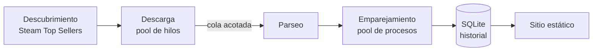

# Radar de Ofertas

[](https://github.com/sebro08-hue/radar-ofertas/actions/workflows/update.yml)

Comparador de precios de videojuegos. Revisa varias tiendas todos los días, empareja el mismo juego entre ellas aunque cada una lo nombre distinto, guarda el historial de precios y publica un sitio estático con las mejores ofertas.

**Sitio:** https://sebro08-hue.github.io/radar-ofertas/

## Qué hace

- Arma el catálogo automáticamente desde los más vendidos de Steam.
- Consulta precios en Steam, GOG, Xbox Store y Amazon; calificaciones de Metacritic y de usuarios de Steam; y duración en How Long To Beat.
- Empareja títulos entre tiendas ("Zelda BOTW" vs. "The Legend of Zelda: Breath of the Wild – Nintendo Switch") con un algoritmo propio de similitud.
- Guarda cada precio observado, sin sobrescribir, para mostrar el historial y marcar mínimos históricos.
- Si una fuente falla, publica lo que tiene y avisa qué dato está desactualizado.
- Se actualiza solo todos los días con GitHub Actions y se publica en GitHub Pages.

## Cómo funciona



El pipeline tiene tres modos de ejecución con el mismo código, útiles para medir y depurar:

| Modo | Descarga | Emparejamiento |
|---|---|---|
| `sequential` | una solicitud a la vez | un solo hilo |
| `concurrent` | pool de hilos | un solo hilo |
| `parallel` | pool de hilos | repartido entre núcleos |

Las descargas respetan un límite de conexiones por sitio, tienen timeout y reintentos con backoff exponencial y jitter. Lo que sigue fallando se reintenta una vez más al final y queda registrado en el panel de métricas.

## Inicio rápido

Requiere Python 3.11 o superior.

```bash
git clone https://github.com/sebro08-hue/radar-ofertas.git
cd radar-ofertas
python3 -m venv .venv && source .venv/bin/activate
pip install -r requirements.txt

python -m radar init-db
python -m radar discover          # llena el catálogo
python -m radar run --limit 20    # primera corrida corta
python -m radar build-site        # genera site/dist
python3 -m http.server -d site/dist 8000
```

## Uso

```bash
python -m radar run [--mode sequential|concurrent|parallel] [--source live|replay]
                    [--fetch-workers N] [--match-workers N] [--match-executor process|thread]
                    [--limit N] [--discover]
```

### Catálogo

```bash
python -m radar games list
python -m radar games add "Hollow Knight" --alt "Hollow Knight: Voidheart Edition" --platform PC "Nintendo Switch"
python -m radar games set 42 hltb_id 68151      # id de la URL howlongtobeat.com/game/68151
python -m radar games remove 42
python -m radar games import juegos.csv
```

### Modo replay

En modo `live`, cada respuesta se guarda en `data/replay/`. El modo `replay` sirve esas mismas respuestas desde un servidor local con latencia configurable. Así se puede trabajar sin internet, depurar parsers o medir rendimiento con resultados repetibles.

```bash
python -m radar run --source replay --start-replay --latency-ms 150 --jitter-ms 50
```

### Benchmarks

```bash
python bench/run_sweeps.py          # barrido de workers: speedup, eficiencia, Karp–Flatt
python bench/contention.py          # estrategias de agregación entre hilos
```

Los resultados quedan en `bench/results/`. El último resumen aparece en la página de métricas del sitio.

### Calidad del emparejamiento

```bash
python -m radar validate-matching --sweep
```

Mide precisión y exhaustividad contra `data/validation_pairs.csv` (pares revisados a mano) para varios umbrales.

## Fuentes

| Fuente | Datos | Acceso |
|---|---|---|
| Steam | catálogo, precio, reseñas de usuarios | HTML (catálogo) y API de precios por lotes de 100 |
| GOG | precio | API pública de catálogo |
| Xbox Store | precio y plataformas (Xbox One, Series X\|S, PC) | HTML; enlace por sitemap, 150 juegos por día en rotación |
| Amazon | precio (físico y digital) | HTML, 100 juegos por día en rotación |
| Metacritic | Metascore | HTML |
| How Long To Beat | duración | HTML, por id del juego (cargado a mano en `data/ids_manual.csv`) |
| IGDB | duración de respaldo para juegos sin id de HLTB | API (`game_time_to_beats`), por id de Steam |

El scraper se identifica con su propio User-Agent, limita las solicitudes por dominio, usa caché local y no intenta saltarse bloqueos ni CAPTCHAs. Si un sitio rechaza las solicitudes varias veces seguidas, un cortacircuitos deja de consultarlo el resto de la ejecución y sus datos quedan marcados como desactualizados.

Los sitios más sensibles se consultan con una pausa mínima entre solicitudes (`per_domain_interval_s`) y en rotación (`rotation`): cada día se revisan los juegos que llevan más tiempo sin consultarse, y el sitio muestra la fecha de cada precio.

## Duraciones

How Long To Beat no ofrece una forma permitida de encontrar juegos de manera automática: su `robots.txt` prohíbe `/api`, que es su búsqueda, y no publica sitemap. Por eso:

1. **IDs de HLTB a mano:** `data/ids_manual.csv` trae los juegos del catálogo, con los publicados primero, y un enlace de búsqueda por cada uno. Se busca el juego, se copia el número de `howlongtobeat.com/game/<id>` en la columna `hltb_id` y se sube el cambio por PR. Cada corrida aplica la hoja sola. Las columnas `metacritic_slug` y `xbox_url` sirven para corregir a mano un enlace que el sistema encontró mal.
2. **IGDB de respaldo:** para los juegos sin `hltb_id`, la duración sale de la API de IGDB por id de Steam. Necesita credenciales de Twitch como secretos del repositorio: `IGDB_CLIENT_ID` e `IGDB_CLIENT_SECRET`. Sin ellas, esta fuente se omite.

El sitio muestra HLTB cuando existe e indica la fuente de cada duración.

## Estructura

```
radar/            código del pipeline
  scrapers/       una fuente por módulo
  matching/       normalización y similitud de títulos
bench/            benchmarks
config/           settings.yaml
data/             base SQLite y pares de validación
site/static/      sitio (HTML + JS, sin backend)
tests/
```

## Tests

```bash
python -m unittest discover tests
```
